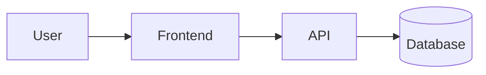

# Technical Design — <project>

## Revision history
| Version | Date | Author | Change | Reason |
|---|---|---|---|---|
| 1.0 | YYYY-MM-DD | planner (agent) | Initial draft | PRD-v1.0 |

## 1. Context and goals
<What this design delivers, for which PRD version, and the constraints it works within.>

## 2. Architecture overview

| Component | Responsibility | Technology | New / existing |
|---|---|---|---|

## 3. REQ coverage
| REQ | Components | API operations | Data entities | Notes |
|---|---|---|---|---|
| REQ-001 | | `POST /...` | | |

## 4. Data model
| Entity | Field | Type | Constraints | Notes / personal data? |
|---|---|---|---|---|

<Migrations needed, indexes, retention.>

## 5. API
Contract: `api-contract-v1.0.yaml`. Summary:
| Operation | Purpose | Auth | REQs |
|---|---|---|---|

## 6. Key flows
<Sequence diagrams or numbered steps for the main and error paths.>

## 7. Security and privacy
<Authentication, authorization per role, input validation, secrets, personal-data handling, audit logging.>

## 8. Errors, logging and observability
<Error model, what is logged (never secrets or personal data), metrics, alerts.>

## 9. Non-functional requirements
| REQ | How it is met | How it is verified |
|---|---|---|

## 10. Testing strategy
| REQ | Acceptance criteria | Unit | Integration | E2E |
|---|---|---|---|---|
| REQ-001 | AC-001.1, AC-001.2 | ✓ | ✓ | AC-001.1 |

## 11. Rollout and migration
<Feature flags, data migration, backward compatibility, rollback plan.>

## 12. Decisions and alternatives
| ADR | Decision | Status |
|---|---|---|

## 13. Risks and open questions
| Item | Type (risk / Q-ID) | Mitigation / blocking |
|---|---|---|
