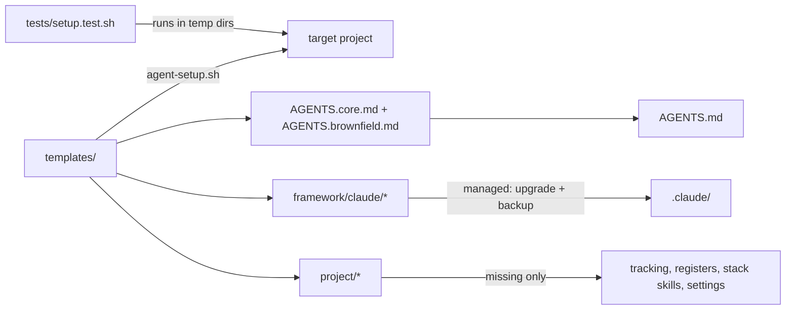

# Architecture Map — agentic-sdlc

## Revision history
| Version | Date | Author | Change | Reason |
|---|---|---|---|---|
| 1.0 | 2026-11-12 | main session (Claude) | Initial map after the v2 restructure | SRC-001 |
| 1.0 | 2026-11-13 | Project owner | Approved | SRC-004 |

## Purpose
This repository is an **installer**. It produces no running application. `agent-setup.sh` copies `templates/` into a target project to set up the agentic SDLC workflow. The repository also uses the framework on itself; its own `.claude/`, `docs/`, `requirements/` and `tracking/` are an installed copy.

## Components

| Component | Responsibility | Evidence |
|---|---|---|
| `agent-setup.sh` | Parses `--type`, builds AGENTS.md, installs file trees (managed or missing-only), detects legacy files, prints next steps | `agent-setup.sh` |
| `templates/framework/` | Agents (planner, developer, reviewer) and core skills, upgraded on every run | `templates/framework/claude/` |
| `templates/brownfield/` | Onboarding agent and `docs/00-onboarding/`, for existing projects only | `templates/brownfield/` |
| `templates/project/` | User-owned files: logs, registers, stack skills, settings, CHANGELOG | `templates/project/` |
| `tests/setup.test.sh` | Scenario tests: new, existing, re-run, legacy upgrade, bad input | `tests/setup.test.sh` |

## Build, test, run
See `.claude/skills/stack-bash/SKILL.md`.

## Known risks and tech debt
- No CI runs the tests yet.
- The YAML validity check is skipped when PyYAML isn't installed.
